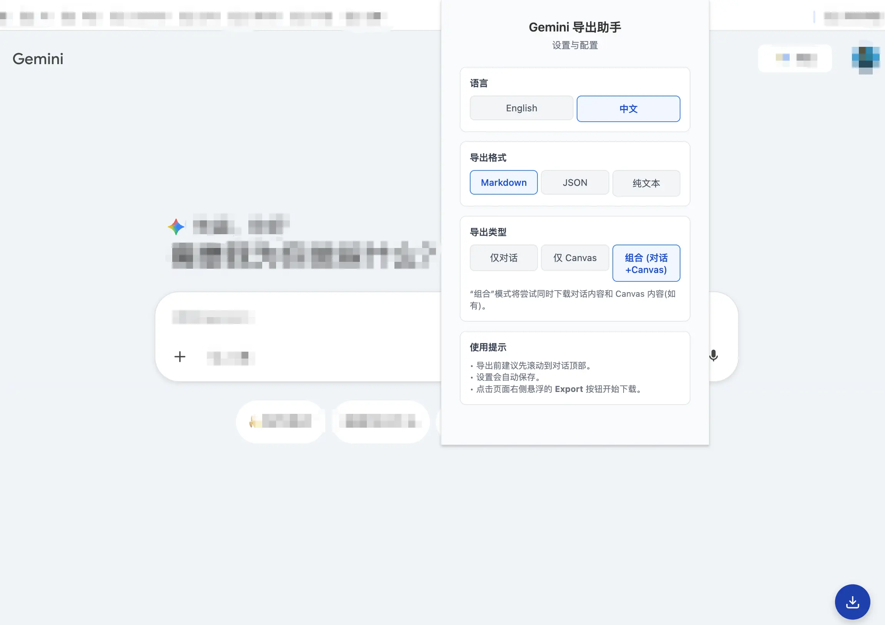

# AI Chat Export Chrome Extension

Chrome extension for exporting conversations from Gemini and ChatGPT as Markdown, JSON, or plain text. The extraction layer is platform-aware, while formatting, download, and packaging stay shared.



## What It Supports

- Gemini conversation export
- ChatGPT conversation export
- Markdown, JSON, and TXT output
- Dialog-only export on both platforms
- Gemini canvas export
- Gemini generated-image export with optional visible watermark removal
- Thread anchor panel for long conversations
- English and Chinese popup UI

## Platform Behavior

### Gemini

- Extracts user messages, assistant responses, and Gemini thought blocks when available
- Supports `Dialog`, `Canvas`, and `Both`
- Can export generated images
- Can optionally attempt visible watermark removal during image export
- File naming prefers Gemini page metadata and falls back to the first user prompt

### ChatGPT

- Extracts turns from `article [class*="group/turn-messages"]`
- Detects user messages via `.user-message-bubble-color`
- Supports `Dialog` export
- Reuses the shared anchor panel and export pipeline
- File naming prefers `document.title`, which maps better to ChatGPT thread titles than DOM headings

## Architecture

The codebase is split into two layers:

1. Platform layer
   - URL detection
   - platform capability flags
   - DOM selectors
   - title extraction rules
   - scroller and anchor hints

2. Shared export layer
   - markdown conversion
   - export formatting
   - file download
   - popup settings
   - floating export UI

This keeps Gemini-specific and ChatGPT-specific DOM logic out of the shared export pipeline.

## Installation

1. Clone this repository.
2. Open `chrome://extensions/`.
3. Enable `Developer mode`.
4. Click `Load unpacked`.
5. Select this repository directory.

## Usage

1. Open a supported conversation page on [Gemini](https://gemini.google.com/) or [ChatGPT](https://chatgpt.com/).
2. Open the extension popup and choose:
   - language
   - export format
   - export type
   - Gemini watermark-removal option if needed
3. Click the floating `Export` button on the page.
4. Wait for the download to complete.

## Export Types

- `Dialog`: exports the conversation turns
- `Canvas`: exports Gemini canvas content only
- `Both`: combines Gemini dialog and canvas content when both exist

For ChatGPT, `Canvas` and `Both` currently degrade to dialog-only behavior because ChatGPT canvas/artifact support has not been implemented in this extension.

## Thread Anchor Panel

- Rendered on supported pages as a right-side panel
- Collapsed by default
- Shows turn snippets for quick navigation
- Uses platform-specific message sources under a shared UI

## Development

### Project Structure

```text
gemini-export/
├── manifest.json
├── assets/
├── src/
│   ├── background/
│   ├── content/
│   │   └── modules/
│   │       ├── platforms.js
│   │       ├── conversation_extractor.js
│   │       ├── project_utils.js
│   │       ├── scroller.js
│   │       └── ...
│   ├── popup/
│   └── lib/
├── tests/
└── README.md
```

### Local Verification

Install test dependencies once:

```bash
npm install
```

Run tests:

```bash
npm test
```

### Manual Checks

- Refresh the unpacked extension in `chrome://extensions/`
- Verify export on a Gemini conversation
- Verify export on a ChatGPT conversation URL like `https://chatgpt.com/c/<thread-id>`
- Check that ChatGPT filenames use the page title

## Notes

- All extraction runs locally in the browser.
- No conversation data is uploaded by the extension.
- ChatGPT DOM structure can change without notice; selectors are centralized so future updates stay local to the platform layer.

## Reference

Inspired by [gemini_chat_export](https://github.com/Sxuan-Coder/gemini_chat_export).
